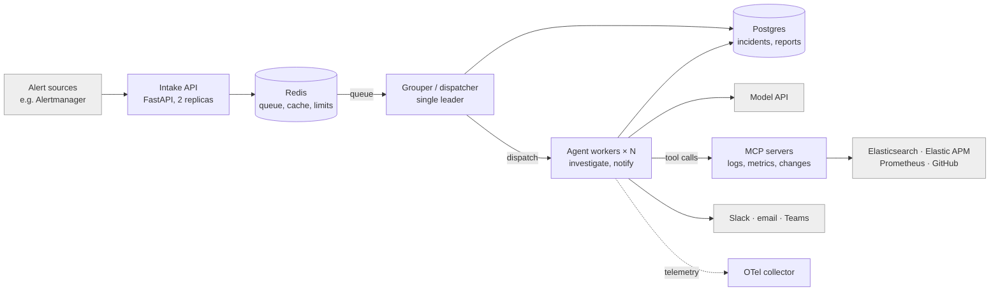
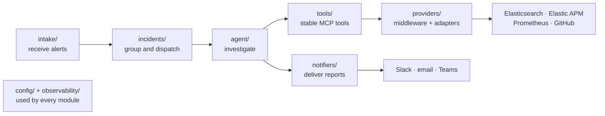
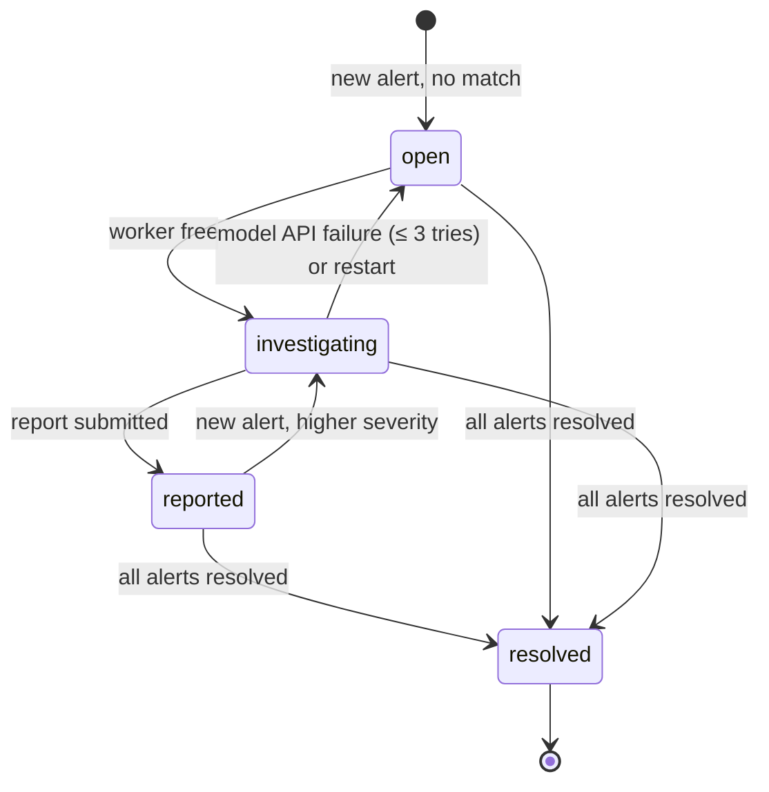

# Design

The contracts an implementation must satisfy: module layout, interfaces, schemas and flows. Requirement ids in brackets show what each part satisfies.

## Runtime topology

Unbreak AI runs as a few small, stateless services around two stores, so each piece scales on its own and a restart loses no work [REQ-INT-09, 13].



| Component | Runs as | Scales by | State it owns |
| --- | --- | --- | --- |
| Intake API (FastAPI) | Container, 2 replicas behind a load balancer | Replicas | None; writes alerts to Redis |
| Redis | Managed service or container | Vertical | Alert queue (Streams), shared query cache, rate-limit buckets, circuit-breaker state |
| Postgres | Managed service or container | Vertical | Incidents, alerts, reports, deliveries, feedback |
| Grouper and dispatcher | One active process; a standby takes over via a Postgres advisory lock | Not scaled (single leader) | None |
| Agent workers | Containers running N worker processes | Worker count | None; each investigation is one task |
| MCP servers (logs, metrics with traces, changes) | Long-lived services over MCP streamable HTTP | Replicas | None locally; middleware state in Redis |
| Notifier sender | Inside the agent workers in v1 | With workers | Delivery records in Postgres |
| OpenTelemetry Collector | Container | Not scaled in v1 | Forwards Unbreak AI's own traces to any OTLP backend (Elastic APM works) |
| Model API | External | Rate limits from the provider | None |

MCP servers run as shared services rather than per-worker subprocesses, so the 60-second cache and per-provider rate limits apply across all concurrent investigations [REQ-PRV-08, 09]. Local development runs everything from one Docker Compose file.

## Package layout

The project is named Unbreak AI, after what on-call engineers want: production unbroken. It investigates incidents today and will fix them later. It is one Python 3.12 repository, named as in the table below, async throughout, packaged with `uv`. Alerts flow left to right through four modules, and only `providers/` ever talks to a vendor system, so the agent stays the same whichever backends are configured.

**Naming conventions**

| Context | Name | Convention |
| --- | --- | --- |
| Product and display name | Unbreak AI | Title case in docs, the README and notifications |
| GitHub repository | `unbreak-ai` | Lowercase, hyphenated |
| PyPI distribution | `unbreak-ai` | `pip install unbreak-ai`; hyphens are the canonical normalized form (PEP 503) |
| Import package | `unbreak_ai` | Lowercase with underscores (PEP 8); `import unbreak_ai` |
| Class names | `UnbreakAI…` | CapWords with the acronym fully capitalized (PEP 8), e.g. `UnbreakAIProviderError` |
| Environment variables | `UNBREAK_AI_*` | Uppercase with underscores, e.g. `UNBREAK_AI_CONFIG` for the config file path |
| Container images | `unbreak-ai-intake`, `unbreak-ai-worker` | Lowercase, hyphenated, one per service |
| OpenTelemetry service names | `unbreak-ai-intake`, `unbreak-ai-worker` | Same as the image names, so traces map to deployments |

The short name `unbreak` is already taken on PyPI by an unrelated resilience library, which is why the distribution and import names carry the `-ai` / `_ai` suffix.



**What each module owns**

| Layer | Module | Owns | Requirements |
| --- | --- | --- | --- |
| Entry | `intake/` | Webhook receiver, authentication, alert normalization | REQ-INT-01, 02 |
| Orchestration | `incidents/` | Incident store, dedupe and grouping, priority dispatch to workers | REQ-INT-03..13 |
| Reasoning | `agent/` | Tool-use loop, model-client interface (`llm.py`), prompts, limits, prompt caching, report validation, evidence check | REQ-AGT-* |
| Agent interface | `tools/` | MCP servers with stable tool names; output formatting and size caps | REQ-PRV-02, 05, 06 |
| Integration | `providers/` | Protocols, registry, middleware and vendor adapters | REQ-PRV-01, 03, 04, 07..11 |
| Output | `notifiers/` | Routing, Slack and email adapters, retries, threaded updates, responder feedback | REQ-RPT-02..07, 09 |
| Cross-cutting | `config/`, `observability/` | Settings schema and loader; tracing and transcripts | REQ-PRV-01, REQ-AGT-09, 10 |
| Quality | `evals/`, `tests/` | Eval cases, fixtures and graders; unit, contract, integration and load tests | NFR-01..03, 12 |

**Folder tree**

```text
unbreak_ai/
├── intake/          webhook.py · normalize.py
├── incidents/       store.py · grouping.py · dispatcher.py
├── agent/           loop.py · llm.py · prompts/ · limits.py · report.py · verify.py
├── tools/           logs_server.py · metrics_server.py · changes_server.py · descriptions.py
├── providers/
│   ├── base.py      Protocols, errors, capabilities
│   ├── registry.py  builds providers from config
│   ├── middleware/  rate_limit.py · cache.py · breaker.py · redact.py
│   ├── logs/        elasticsearch.py
│   ├── metrics/     elastic_apm.py · prometheus.py
│   ├── traces/      elastic_apm.py
│   └── changes/     github.py
├── notifiers/       base.py · router.py · slack.py · email.py · feedback.py
├── config/          schema.py · loader.py
└── observability/   tracing.py · transcripts.py
evals/               cases/ · fixtures/ · graders/ · runner.py
tests/               unit/ · contract/ · integration/ · load/
specs/               overview.md · requirements.md · design.md · tasks.md
```

**Rules that keep it simple**

- Dependencies point one way: `agent` → `tools` → `providers`. `providers` never imports `agent` or `tools`; CI enforces this with import-linter.
- Adding a vendor means one new file in `providers/<interface>/`, one registry entry, and a passing contract suite. Nothing else changes.
- Adding a notification channel means one new file in `notifiers/` and a passing notifier contract suite.

## Provider interfaces

Every adapter implements one of these Protocols. Adapters contain only vendor-specific querying and mapping; rate limiting, caching, circuit breaking and redaction are applied by middleware that wraps every provider, with shared state in Redis [REQ-PRV-07..09, NFR-10].

```python
from datetime import datetime
from typing import Protocol
from pydantic import BaseModel

class TimeWindow(BaseModel):
    start: datetime  # UTC
    end: datetime    # UTC

class Scope(BaseModel):
    service: str | None = None
    namespace: str | None = None
    region: str | None = None
    environment: str | None = None

class Provider(Protocol):
    name: str                    # e.g. "elasticsearch", "prometheus"
    capabilities: frozenset[str] # e.g. {"pattern_aggregation", "traces"}

class LogsProvider(Provider, Protocol):
    async def overview(self, scope: Scope, window: TimeWindow) -> "LogOverview": ...
    async def error_patterns(self, scope: Scope, window: TimeWindow, limit: int = 20) -> list["ErrorPattern"]: ...
    async def search(self, scope: Scope, window: TimeWindow, query: "LogQuery",
                     cursor: str | None = None, limit: int = 50) -> "Page[LogRecord]": ...
    async def get(self, ref: str) -> "LogRecord": ...
    async def context(self, ref: str, before: int = 20, after: int = 20) -> list["LogRecord"]: ...

class MetricsProvider(Provider, Protocol):
    async def service_health(self, service: str, window: TimeWindow,
                             baseline: TimeWindow) -> "ServiceHealth": ...
    async def alert_context(self, alert: "Alert", window: TimeWindow) -> "Series": ...
    async def top_movers(self, scope: Scope, window: TimeWindow,
                         baseline: TimeWindow, limit: int = 10) -> list["Mover"]: ...

class TracesProvider(Provider, Protocol):
    async def get_trace(self, trace_id: str) -> "TraceSummary": ...
    async def errors(self, service: str, window: TimeWindow, limit: int = 20) -> list["ErrorGroup"]: ...

class ChangesProvider(Provider, Protocol):
    async def recent_deploys(self, service: str | None, window: TimeWindow) -> list["ChangeEvent"]: ...
    async def diff_summary(self, change_id: str) -> "DiffSummary": ...
    async def config_changes(self, service: str | None, window: TimeWindow) -> list["ChangeEvent"]: ...

class Notifier(Protocol):
    name: str
    async def send(self, report: "Report", incident: "Incident") -> "DeliveryRef": ...
    async def update(self, ref: "DeliveryRef", update: "ReportUpdate") -> None: ...
```

**Errors.** Providers raise only `ProviderTimeout`, `ProviderUnavailable`, `NotSupported` or `ProviderError` (all subclasses of `UnbreakAIProviderError`). The tools layer turns each into a short text message for the agent [REQ-AGT-06, REQ-PRV-04].

**Links.** Every returned model carries a `link` field built by the adapter, or `None` when the vendor has no UI for it [REQ-PRV-05].

## Data models

All models are Pydantic, all timestamps are timezone-aware UTC, and every provider-returned model carries `source` (provider name) and `link` [REQ-PRV-03, 05].

| Model | Key fields | Notes |
| --- | --- | --- |
| `Alert` | `id`, `fingerprint`, `source`, `name`, `severity` (critical/warning/info), `service`, `namespace`, `labels`, `annotations`, `starts_at`, `ends_at`, `status` (firing/resolved), `expr` (the alert's query, when the source provides one) | Normalized from each alert source in `intake/` |
| `Incident` | `id`, `state` (open/investigating/reported/resolved), `severity`, `alerts`, `grouping_reasons`, `created_at`, `updated_at`, `report`, `deliveries`, `feedback` | Severity = highest of its alerts |
| `LogRecord` | `ref`, `timestamp`, `level` (lowercase), `service`, `namespace`, `pod`, `message` (≤ 500 chars in lists), `trace_id`, `source`, `link` | `ref` is opaque to the agent and round-trips to `get` / `context` |
| `LogOverview` | `histogram` (time buckets → count), `top_levels`, `top_services`, `top_pods`, `total` | Counts only, no messages |
| `ErrorPattern` | `pattern`, `count`, `first_seen`, `last_seen`, `services`, `sample_ref` | Pattern normalization as in elk_mcp-server |
| `ServiceHealth` | `service`, `window`, `baseline`, `latency_p95_ms`, `throughput_rpm`, `error_rate`, `deltas`, per-value `source` | Baseline defaults to the same window 24 h earlier |
| `Series` | `signal`, `points` (≤ 60 after resampling), `threshold`, `unit` | |
| `Mover` | `entity`, `signal`, `baseline_value`, `current_value`, `change_pct` | Sorted by absolute change |
| `TraceSummary` | `trace_id`, `root_service`, `duration_ms`, `spans` (≤ 20: slowest and failed), `link` | |
| `ErrorGroup` | `group_key`, `message`, `count`, `first_seen`, `last_seen`, `sample_trace_id` | |
| `ChangeEvent` | `id`, `kind` (deploy/config), `service`, `at`, `author`, `summary`, `version`, `link` | GitHub provider: deploys from the Deployments API when the repo uses it, else merges to the default branch; config changes are commits touching configured paths, such as Helm values |
| `DiffSummary` | `change_id`, `commits`, `files` (≤ 30, path + lines changed), `link` | |
| `Report` | As in the report schema in overview.md | Validated in `agent/report.py` [REQ-RPT-01] |
| `DeliveryRef` | `notifier`, `channel`, `message_id`, `thread_id`, `delivered_at`, `status` | Used for follow-up updates [REQ-RPT-07] |

## Agent tool contracts

The only surface the agent sees. Names and inputs never change between providers [REQ-PRV-02]. Every output is compact text (TSV for lists), at most 8,000 characters, and ends with `source` and `link` lines [REQ-PRV-05, 06]. When `window` is omitted, it defaults to the investigation window [REQ-AGT-01].

| Tool | Inputs | Output | Limits |
| --- | --- | --- | --- |
| `logs_overview` | `scope`, `window?` | Histogram, top levels, services and pods; counts only | — |
| `logs_error_patterns` | `scope`, `window?`, `limit?` | Ranked patterns with count, first/last seen, `sample_ref` | `limit` ≤ 50 |
| `logs_search` | `scope`, `window?`, `level?`, `text?`, `cursor?`, `limit?` | TSV rows (`ref`, time, level, service, message) + `next_cursor` | `limit` ≤ 100 |
| `logs_get_log` | `ref` | One full record, including stack trace | Message ≤ 8,000 chars |
| `logs_context` | `ref`, `before?`, `after?` | TSV rows around that record, same pod/service | ≤ 50 each side |
| `metrics_service_health` | `service`, `window?` | Latency p95, throughput, error rate vs. baseline, with deltas | — |
| `metrics_alert_context` | `alert_id` | The alert's own signal over the window (re-runs the alert's `expr` when available), threshold marked | ≤ 60 points |
| `metrics_top_movers` | `scope`, `window?`, `limit?` | Entities whose signals changed most vs. baseline | `limit` ≤ 20 |
| `traces_get` | `trace_id` | Root service, duration, slowest and failed spans | ≤ 20 spans |
| `traces_errors` | `service`, `window?`, `limit?` | Grouped errors with counts and a sample trace id | `limit` ≤ 20 |
| `recent_deploys` | `service?`, `window?` | Deploys with time, version, author, one-line summary | ≤ 20 |
| `diff_summary` | `change_id` | Commits and changed files with line counts | ≤ 30 files |
| `config_changes` | `service?`, `window?` | Config changes with time and summary | ≤ 20 |
| `submit_report` | `report` (report schema) | Accepted, or validation and evidence errors to fix | Terminal; ≤ 2 corrections [REQ-AGT-03, 04, 08] |

**Tool descriptions** state when to use each tool, not only what it does (for example: "Call `recent_deploys` early: changes cause many incidents and it is cheap"). They live in `tools/descriptions.py` so evals can test variations.

## Config schema

One YAML file, validated at startup by a Pydantic model; `${VAR}` values are read from the environment, and secrets may only come from there [REQ-PRV-01, NFR-09]. overview.md has a full example.

`config.example.yaml` at the repo root is the canonical example and is loaded by a test, so it cannot drift from the schema. Connection settings come from the environment: a field marked *secret* is valid only when its YAML value is a `${VAR}` reference with no default, so inline and defaulted secrets are rejected. `${VAR:-default}` is allowed for non-secret values only.

**Per-type settings (v1)**

| Type | Required settings | Optional settings |
| --- | --- | --- |
| logs / `elasticsearch` | `url`, `api_key` (secret) | `regions[]`, `max_qps` |
| metrics / `elastic_apm` | `url`, `api_key` (secret) | `max_qps` |
| metrics / `prometheus` | `url` | `auth` (secret), `max_qps` |
| traces / `elastic_apm` | `url`, `api_key` (secret) | `max_qps` |
| changes / `github` | `token` (secret), `repos[]` (≥ 1) | `config_paths[]`, `max_qps` |
| notifiers / `slack` | `channel`, `bot_token` (secret) | `routing`, `display_timezone` |
| notifiers / `email` | `to[]` (≥ 1), `smtp_url` (secret) | `routing`, `display_timezone` |

| Key | Type | Default | Notes |
| --- | --- | --- | --- |
| `alert_source.type` | enum: alertmanager | alertmanager | Later: pagerduty, opsgenie, grafana, elastic |
| `alert_source.auth` | secret | required | Bearer token, basic auth or HMAC secret, depending on the source [REQ-INT-01] |
| `providers.logs[]` | list of `{type, ...settings}` | required, ≥ 1 | v1 type: elasticsearch |
| `providers.metrics[]` | list | optional | v1 types: elastic_apm, prometheus |
| `providers.traces[]` | list | optional | v1 type: elastic_apm |
| `providers.changes[]` | list | optional | v1 type: github |
| `providers.*.max_qps` | number | 5 | [REQ-PRV-09] |
| `notifiers[]` | list of `{type, routing, ...settings}` | required, ≥ 1 | v1 types: slack, email |
| `notifiers[].routing.min_severity` | enum | warning | [REQ-RPT-04] |
| `notifiers[].routing.services` | list of strings | all | |
| `notifiers[].display_timezone` | IANA zone | UTC | [REQ-RPT-02] |
| `agent.model` | string | required | Model id |
| `agent.limits` | `{max_tool_calls, max_input_tokens, timeout_s}` | 15, 150000, 240 | [REQ-AGT-05] |
| `agent.daily_budget_usd` | number | 25 | [REQ-AGT-11] |
| `agent.prompt_caching` | bool | true | [REQ-AGT-12] |
| `incidents.grouping_window_s` | int | 300 | [REQ-INT-04, 05] |
| `incidents.workers` | int | 5 | [REQ-INT-08, 09] |
| `incidents.dependency_map` | enum: apm, file, none | apm if a traces provider exists, else none | [REQ-INT-05] |
| `incidents.ignore` | `{min_severity, flappers[]}` | info, [] | [REQ-INT-07] |
| `redaction.patterns[]` | list of regex | emails, bearer tokens, AWS keys | [NFR-10] |
| `retention_days` | int | 30 | [NFR-11] |
| `redis_url` | secret | required | Queue, shared cache, rate limits, breaker state |
| `database_url` | secret | required | Postgres incident store |

## Core flows

**Alert to report**

1. `intake/webhook.py` authenticates the request, normalizes the payload into `Alert` records, writes them to the queue and returns 202 [REQ-INT-01, 02].
2. `incidents/grouping.py` reads the queue. Each alert is ignored, attached to an existing incident by fingerprint, scope or dependency, or opens a new incident [REQ-INT-03..07]. The decision and its reason are stored.
3. `incidents/dispatcher.py` picks the highest-priority open incident when a worker is free and sets it to `investigating` [REQ-INT-08, 09].
4. `agent/loop.py` builds the prompt (incident, alerts, window, tool descriptions) and runs the tool-use loop under the limits [REQ-AGT-01..07]. Each tool call goes `tools/` → middleware → provider, and back as compact text.
5. The agent calls `submit_report`. `agent/report.py` validates the schema, and `agent/verify.py` checks every evidence ref and timestamp against the run's tool outputs. Failures go back to the agent, up to 2 corrections [REQ-AGT-03, 04, 08].
6. The incident is set to `reported`, and `notifiers/router.py` sends the report to every matching notifier, storing a `DeliveryRef` for each [REQ-RPT-04..06].
7. Trace spans and the transcript are flushed to the observability store [REQ-AGT-09, 10].

**Follow-up flows**

- New alert on an `investigating` incident: appended to the running loop's context before its next model call [REQ-INT-10].
- New alert on a `reported` incident: a thread update via each `DeliveryRef`; a follow-up investigation only if severity rose [REQ-INT-11, REQ-RPT-07].
- All alerts resolved: incident set to `resolved`, resolution update posted [REQ-INT-12].
- Restart: incidents in `open` or `investigating` are re-queued; an investigation restarts from scratch and only the first completed report is sent, keyed by incident id [REQ-INT-13].

**Incident states**



Alerts that match an existing incident never create a new state: they attach to it, and only a higher-severity alert sends a reported incident back to investigation [REQ-INT-03..13].

## Error handling

| Failure | Behavior | Requirement |
| --- | --- | --- |
| Invalid webhook payload or failed authentication | 4xx, nothing queued, rejection logged | REQ-INT-02 |
| Queue unavailable at intake | 503 so the alert source retries; health check fails | NFR-08 |
| Provider timeout (20 s) | One retry with backoff, then an error message to the agent | REQ-AGT-06 |
| Provider failing repeatedly | Circuit breaker opens after 5 failures in 60 s and half-opens after 30 s | REQ-PRV-07 |
| Capability not supported | "Not supported by &lt;provider&gt;" text to the agent | REQ-PRV-04 |
| Model API error or rate limit | Retry with exponential backoff up to 3 times; then incident back to `open` with a retry count; after 3 failed attempts, a minimal "investigation failed" report | NFR-08 |
| Limit reached | Forced final report with confidence `low` | REQ-AGT-05 |
| Invalid or ungrounded report | Errors returned to the agent; after 2 corrections, a minimal `low` report | REQ-AGT-04, 08 |
| Notifier delivery failure | 3 retries with backoff, then marked failed; other notifiers continue | REQ-RPT-06 |
| Worker crash mid-investigation | Incident re-queued on restart; idempotent report send | REQ-INT-13 |
| Daily budget exhausted | Non-critical incidents get a single-shot summary | REQ-AGT-11 |
